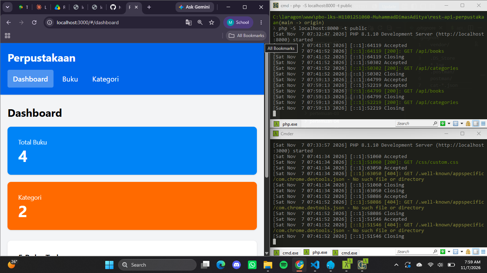
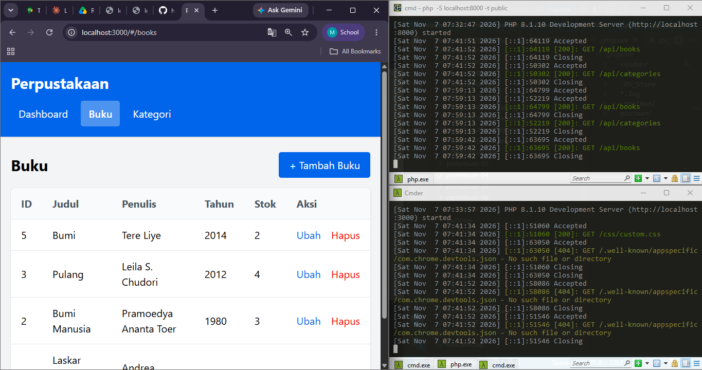
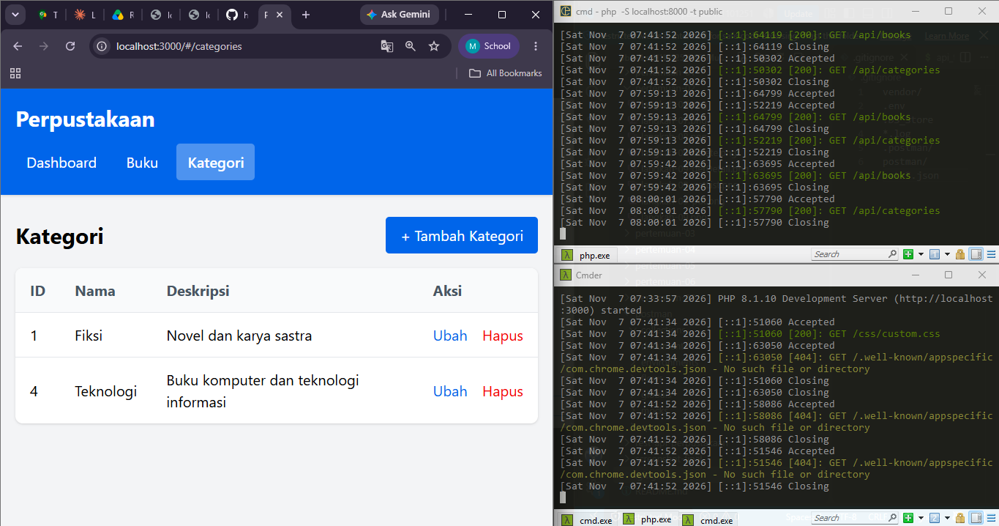

# PBO LKS — Portofolio Praktikum

- **Nama**  : Muhammad Dimas Aditya
- **NIM**   : H1101251060
- **Kelas** : A
- **Mata Kuliah** : Pemrograman Berorientasi Objek
- **Dosen Pengampu** : Syahru Rahmayuda, S.Kom., M.Kom.

## Deskripsi

REST API Perpustakaan dengan PHP modern (PSR-4, Composer), arsitektur MVC, prinsip SOLID, pola Repository dan Dependency Injection, database MySQL, serta frontend terpisah dengan Tailwind CSS.

## Fitur

- CRUD Buku (`/api/books`)
- CRUD Kategori (`/api/categories`)
- Validasi input (422), penanganan 404 dan 500
- CORS untuk frontend terpisah
- Frontend: Dashboard (statistik + 5 buku terbaru), halaman Buku, halaman Kategori, modal form, notifikasi toast

## Cara Menjalankan

Prasyarat: PHP 8+, Composer, MySQL.

**Backend**

```
cd rest-api-perpustakaan
composer install
copy .env.example .env
mysql -u root -p < database/schema.sql
php -S localhost:8000 -t public
```

Sesuaikan `DB_USERNAME` dan `DB_PASSWORD` di `.env`.

**Frontend** (terminal lain)

```
cd frontend-perpustakaan
php -S localhost:3000
```

Buka `http://localhost:3000`.

## Bukti per Pertemuan

- [x] [Pertemuan 1 — Setup & Database](pertemuan-01/)
- [x] [Pertemuan 2 — Core OOP](pertemuan-02/)
- [x] [Pertemuan 3 — Framework & Routing](pertemuan-03/)
- [x] [Pertemuan 4 — Testing Backend](pertemuan-04/)
- [x] [Pertemuan 5 — CRUD Kategori](pertemuan-05/)
- [x] [Pertemuan 6 — Frontend](pertemuan-06/)
- [x] [Pertemuan 7 — Integrasi & Finalisasi](pertemuan-07/)

## Screenshot Aplikasi



